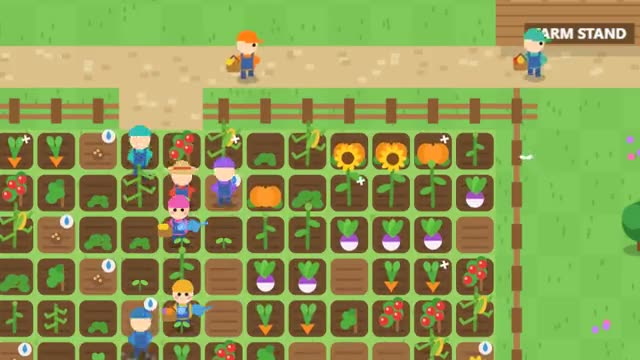

# Farm Together

Grow one farm with friends. It keeps growing. A multiplayer starter game from [Multiplayer Agent](https://multiplayeragent.com): 2D, co-op, 1–8 players, with bot farmhands who help out.

## How it plays

Tap a plot and your farmer tills it, plants it, waters it and harvests it. Crops grow in real time, even while you're away. Sell your basket at the stand and spend the farm's coins on new crops.

**Controls:** Tap or click plots (drag to do a row), tap the stand to sell; WASD + Space, 1–6 for seeds.

## Make it yours in the Game Builder

Open the [Game Builder](https://multiplayeragent.com), choose **Start from a starter game** and pick Farm Together. It opens as version 1 in your studio, ready to play and publish. Then ask for changes, for example:

- Add chickens that lay eggs you can sell
- Add rain that waters every crop at once
- Let crows steal ripe crops unless you build a scarecrow

## Run it yourself

1. Get a free publishable key (`pk_…`) at [multiplayeragent.com](https://multiplayeragent.com).
2. In `index.html`, put it in place of `pk_REPLACE_ME` in the `MP_CONNECT` block.
3. Open `index.html` in a browser. No build step and no server needed.

Without a key it still runs, offline with bot farmhands, and remembers your farm in this browser.

## How it is built

- One `index.html`. The comment at the top of the script maps the code and explains the multiplayer.
- **World memory:** The farm is remembered by the players who worked it. Every player saves a copy every 10 seconds and when they leave; whoever comes back first brings it back for everyone, and a copy with more work in it replaces a newer, emptier one. Crops are stored with the time they ripen, so they keep growing while nobody is there.
- **Host-run rules:** The host's browser checks every till, plant, water, harvest and sale, and keeps the farm's coins. If it leaves, the next player takes over.
- **Bots:** Farmhands work the field and sell at the stand until enough people join.
- **Live ops:** Make crops grow faster (`growSpeed`) or sell for more (`priceBonus`) from the live config, with no new deploy. A running live event's title shows on screen.
- **Leaderboard:** Coins each player has earned at the stand, all time, under the trophy button.
- **Live sync:** Everyone sees every plot, crop and farmer change at once.
- `?attract` runs it offline with bots only. The preview video is recorded from it.

## License

MIT.
